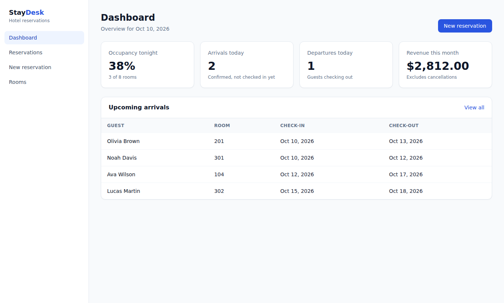
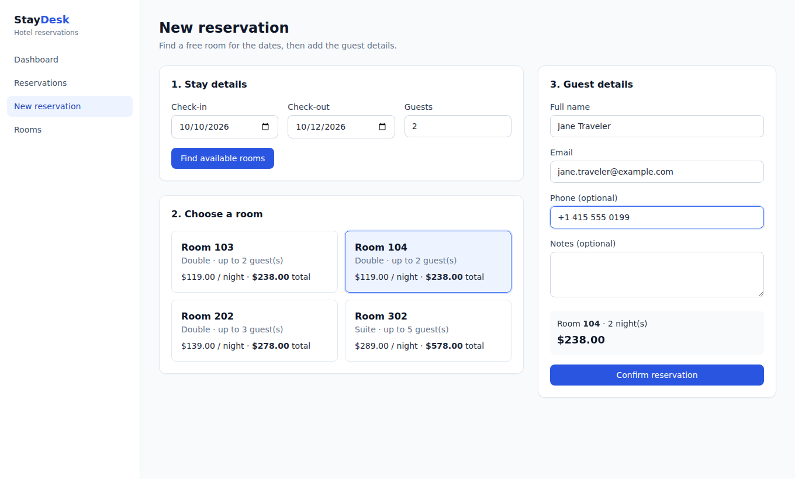

# StayDesk — Hotel Reservations Dashboard

A full-stack reservation management app for a small hotel: front-desk staff can check room
availability, book guests, move a stay through check-in / check-out, and see today's occupancy
and revenue at a glance.

**Stack:** Next.js 16 (React 19) · Node.js + Express · PostgreSQL 16 · Zod · Jest + Supertest · Vitest · Tailwind CSS · Docker



---

## Features

| Area | What it does |
| --- | --- |
| **Dashboard** | Occupancy tonight, arrivals and departures for the day, revenue this month, upcoming arrivals |
| **Reservations** | Server-side search (guest, email, room), status filter, pagination, status actions (check in / check out / cancel) |
| **New reservation** | Pick dates and group size → live list of free rooms with the calculated total → guest details → confirm |
| **Rooms** | Room inventory, nightly rates, add rooms, disable a room for maintenance |
| **API** | REST endpoints with input validation, consistent error format, correct HTTP status codes |



---

## Feature case study: preventing double bookings end-to-end

The most important rule in a booking system is that **one room can never be sold twice for the same night**.
This feature touches all three layers, so it is a good example of how I work across frontend, API and database.

**1. Database — the final guarantee.**
An exclusion constraint makes overlapping active reservations for the same room impossible, no matter where
the insert comes from (API, script, admin tool):

```sql
CONSTRAINT reservations_no_overlap EXCLUDE USING gist (
  room_id WITH =, daterange(check_in, check_out, '[)') WITH &&
) WHERE (status <> 'cancelled')
```

The `[)` range means check-out day is free again, so back-to-back stays (out on the 13th, next guest in on the 13th) are allowed.

**2. API — a clear answer instead of a database error.**
`POST /api/reservations` runs in a transaction, locks the room row (`SELECT ... FOR UPDATE`) so two
simultaneous requests are processed one after another, checks capacity and overlap, and returns
`409 ROOM_NOT_AVAILABLE` with a human-readable message. If anything still reaches the constraint,
the error handler maps PostgreSQL error `23P01` to the same 409 response.

**3. Frontend — the user is never stuck.**
If the room is taken between "search" and "confirm" (another receptionist booked it), the form shows a
clear message and refreshes the list of available rooms automatically, keeping the guest details already typed.

**4. Tests that prove it.**
- 5 requests for the same room at the same time → exactly one `201`, four `409`
- an overlapping booking → `409`; a back-to-back booking → `201`; a cancelled booking frees the room
- a raw SQL insert that bypasses the API is still rejected by the database (`23P01`)

---

## Architecture

```
web/  (Next.js, client components)
  └─ lib/api.js        fetch wrapper: JSON, error format -> ApiError(code, message, fields)
  └─ lib/useApi.js     data loading hook: loading / error / reload, aborts stale requests
        │  HTTP JSON
        ▼
api/  (Express)
  └─ modules/<feature>/routes     validation with zod (400 + field errors)
  └─ modules/<feature>/service    SQL + transactions, business errors (404 / 409 / 422)
  └─ reservation.rules.js         pure business rules (nights, price, status workflow)
  └─ middleware/errorHandler      one error format for the whole API, maps PostgreSQL errors
        │  pg (parameterized queries only)
        ▼
PostgreSQL  (constraints: CHECKs, UNIQUE, FOREIGN KEYs, exclusion constraint)
```

Error format used by every endpoint:

```json
{ "error": { "code": "VALIDATION_ERROR", "message": "Please check the highlighted fields",
             "details": { "guest.email": "Invalid email address" } } }
```

The frontend maps `details` straight onto the form fields.

---

## API reference

| Method | Endpoint | Description |
| --- | --- | --- |
| GET | `/api/health` | Health check (also checks the database connection) |
| GET | `/api/dashboard?date=YYYY-MM-DD` | Daily stats + upcoming arrivals |
| GET | `/api/rooms?type=&active=` | List rooms |
| POST | `/api/rooms` | Create a room |
| PATCH | `/api/rooms/:id` | Update rate / capacity / active flag |
| GET | `/api/rooms/availability?checkIn=&checkOut=&guests=` | Free rooms for a stay, with total price |
| GET | `/api/reservations?status=&search=&from=&to=&page=&pageSize=` | Paginated list |
| GET | `/api/reservations/:id` | One reservation |
| POST | `/api/reservations` | Create (guest matched by email or created) |
| PATCH | `/api/reservations/:id/status` | Change status (allowed: confirmed → checked_in / cancelled, checked_in → checked_out) |
| GET | `/api/guests?search=` | Guests with number of stays |

---

## Getting started

Requirements: **Node.js 22.12+**, **Docker Desktop** (or your own PostgreSQL 16).

```bash
# 1. Database (PostgreSQL on localhost:5433, plus a separate test database)
docker compose up -d

# 2. API  ->  http://localhost:4000
cd api
cp .env.example .env          # Windows PowerShell: Copy-Item .env.example .env
npm install
npm run db:migrate
npm run db:seed               # demo rooms, guests and reservations around today's date
npm run dev

# 3. Web  ->  http://localhost:3000   (in a second terminal)
cd web
cp .env.example .env.local    # Windows PowerShell: Copy-Item .env.example .env.local
npm install
npm run dev
```

## Tests

```bash
cd api && npm test     # 26 API tests: rules, validation, availability, concurrency, dashboard (real PostgreSQL)
cd web && npm test     # API client + formatting unit tests
cd web && npm run lint && npm run build
```

The API tests run against the separate `staydesk_test` database. GitHub Actions runs the same
checks on every push (`.github/workflows/ci.yml`).

---

## Project structure

```
01-staydesk/
├── api/
│   ├── src/
│   │   ├── app.js, server.js, config.js
│   │   ├── db/            pool, migration runner, seed, migrations/*.sql
│   │   ├── lib/           HttpError helpers, zod validation middleware
│   │   ├── middleware/    error handler (incl. PostgreSQL error mapping)
│   │   └── modules/       rooms, guests, reservations, dashboard
│   └── tests/             Jest + Supertest
├── web/
│   ├── app/               dashboard, reservations, reservations/new, rooms
│   ├── components/        sidebar, badges, loading / empty / error states
│   ├── lib/               api client, data hook, formatting
│   └── tests/             Vitest
├── db-init/               creates the test database in Docker
└── docker-compose.yml
```

## Decisions and known limitations

- **Dates are calendar dates, not timestamps.** `DATE` columns are returned as `YYYY-MM-DD` strings and all
  date math is done in UTC, so a stay never shifts by one day because of the server's or browser's time zone.
- **Money** is stored as `NUMERIC(10,2)` and rounded to cents after multiplication.
- **Authentication is out of scope** for this demo; in production the API would sit behind login with
  role-based access (front desk vs. manager).
- Prices are per room per night; seasonal rates and taxes would be the next feature.
